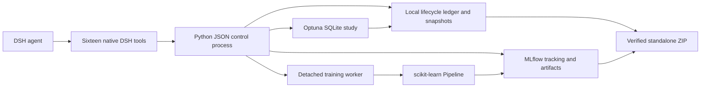
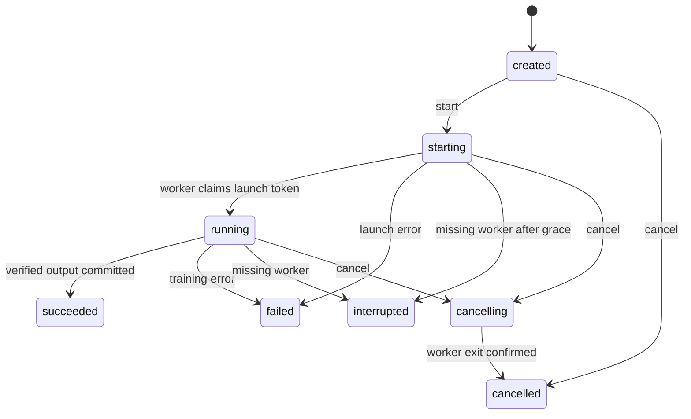

# Architecture and guarantees

The TypeScript plugin registers tools through the DSH SDK. Each call starts a short Python control process with an argument array, never a command shell. Standard input/output carries one versioned JSON message. Standard error carries diagnostics. Abort/timeout terminates that control request; an explicitly started worker has an independent lifetime. `cancel` is the operation that stops training.

The backend uses a filesystem lock across controllers and workers. A SQLite lifecycle ledger stores state, events, ownership and request keys. MLflow owns experiment IDs, run IDs, parameters, metric history and artifacts. A created snapshot has MLflow status RUNNING but precise lifecycle tag `mlwb.state=created`. Successful runs are FINISHED; cancellation is KILLED; failure/interruption is FAILED.

A worker is identified by PID **and process creation time**, with a launch token for ownership. Concurrent `start` calls are serialized. Output is written to a pending directory and committed only after fitting, MLflow logging and input verification. Missing workers are reconciled on `get`/`list`; there is no daemon pretending that a killed fit is complete. Cancellation confirms process termination. Changes create a child run; a terminal run is never restarted in place.

Each run has a snapshotted CSV, exact train/test row indices, JSON config, engine code, optional factories, core environment versions and pinned requirements. SHA-256 hashes anchor inputs and outputs in the ledger. This detects accidental edits and mismatched exports; it is not a signed, tamper-proof audit system against a user who controls the entire root.

Comparison requires the same dataset bytes, split indices, task, target and evaluator contract. New v0.2 runs additionally bind the recipe SHA-256 and pandas/numpy versions, alongside scikit-learn and parsing policy. It checks successful output integrity and MLflow status/metrics before ranking. MLflow input/output artifact copies are checked against the same hashes, so a runs:/ URI cannot silently diverge from an exported local model. It does not prove that the dataset is scientifically appropriate. Explicit group/time splits address their stated boundaries; they do not detect arbitrary leakage or implement forecasting.

Branching normally copies the parent's fitted transformer. Both comparison and preprocessing fingerprints must match, preventing application of a fitted transformer to another split. Reuse=false keeps the snapshotted sources but refits processing in a new run. Parameter overrides replace fields rather than recursively merging dictionaries. Custom factories are optional reviewed local Python and must produce scikit-learn-compatible objects.

Fitted-preprocessor branches now keep the parent's snapshotted engine and evaluator identity as well. This permits v0.1 records to remain usable after upgrading, provided the core library versions match. Refitting without reuse switches to the current recipe; old and new evaluators are not automatically compared. Terminal MLflow status is committed before a successful lifecycle state is saved.

Optuna owns search history and parameter sampling. The adapter persists an idempotent child-branch request before launching each trial, recovers a lost run link from the lifecycle request ledger and advances one trial at a time. Study cancellation is persisted before stopping the active fit. There is no scheduler daemon: step/get polls reconcile completion and timeout; only step can start the next fit. See [TUNING.md](TUNING.md).

The export includes the full fitted pipeline, result and predictions, training inputs (CSV optional), report, environment, a checksum manifest and standalone reproduction script. It is made from the verified run snapshot, not from whatever code is currently open in DSH. The reproduction process reconstructs the fit and compares metrics with absolute tolerance 1e-8 / relative tolerance 1e-7. Byte-identical model serialization across machines is not promised.

The backend is local, single-user and same-host. No HTTP server, shared multi-user auth, remote tracking service, SSH execution, optimizer checkpointing, or automatic retry of training is implemented. Files may contain confidential training data and fitted model information; the root and explicitly exported ZIP remain the user's local responsibility. The plugin never sends those artifacts to GitHub.
